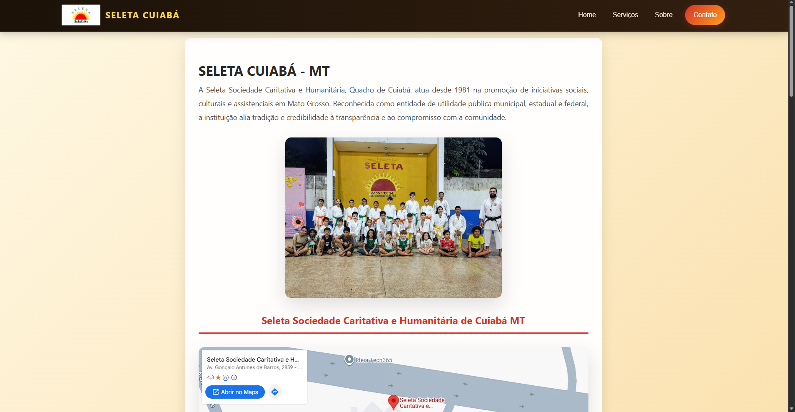
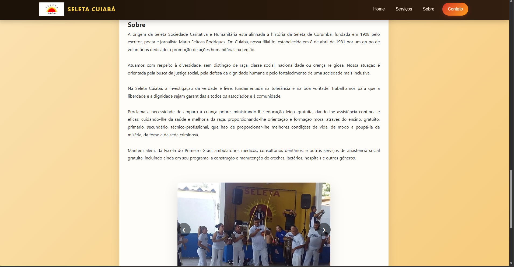

# Site Institucional – Seleta Sociedade Caritativa e Humanitária de Cuiabá

Site institucional desenvolvido para a Seleta Sociedade Caritativa e Humanitária de Cuiabá, com o objetivo de ampliar a visibilidade da instituição junto à comunidade.

> Projeto de Extensão – UNIC (Jun/2026)

## Acesse o site

🔗 <https://siteseleta.github.io/SSCH/>

## Sobre o projeto

O site apresenta a instituição e suas atividades ao público, facilitando o acesso às informações e divulgando o trabalho realizado na comunidade. Foi desenvolvido de forma individual como parte do projeto de extensão da graduação.

## Tecnologias

- HTML
- CSS
- JavaScript
- GitHub Pages (hospedagem)

## Capturas de tela

 
 
 

## Autor

**Iuri Dias de Castro**
[GitHub](https://github.com/iuri-Castro)
